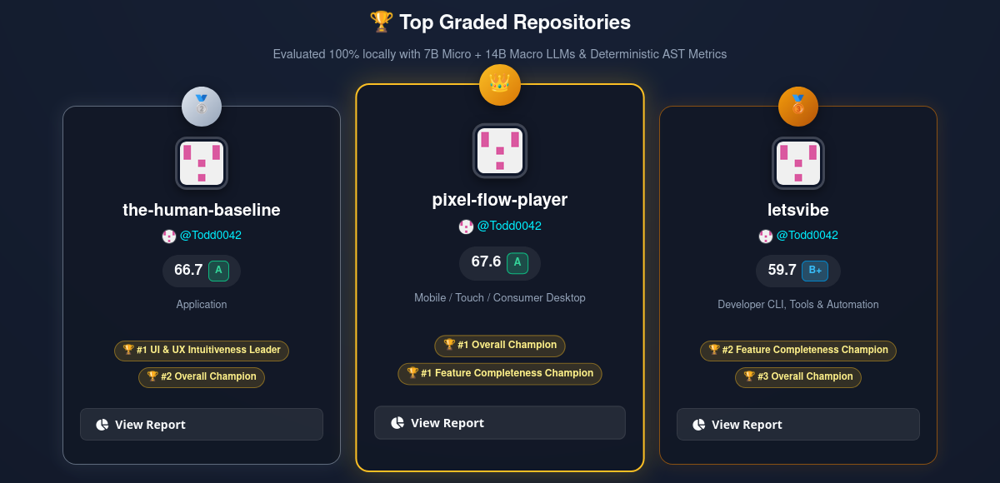
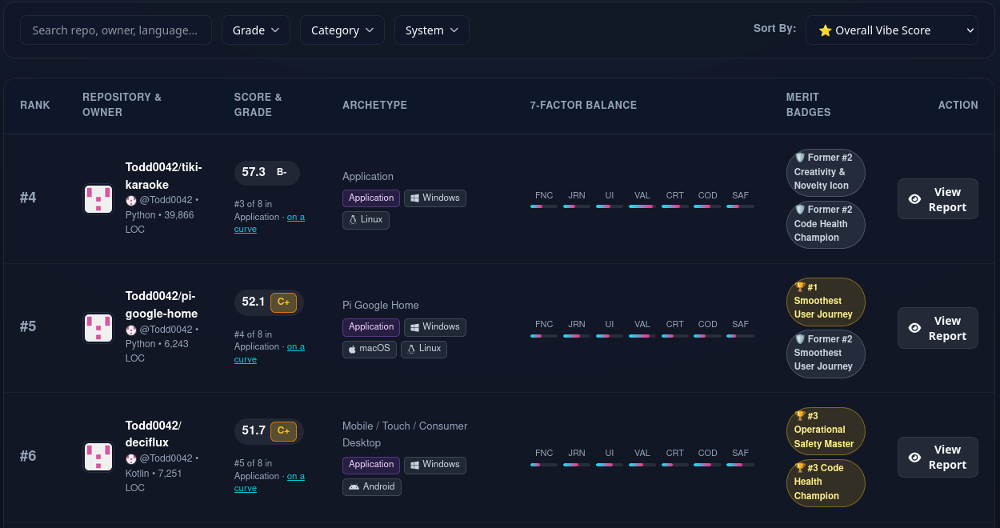
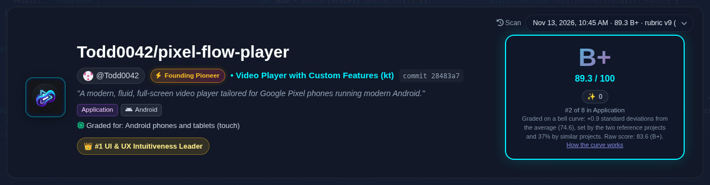
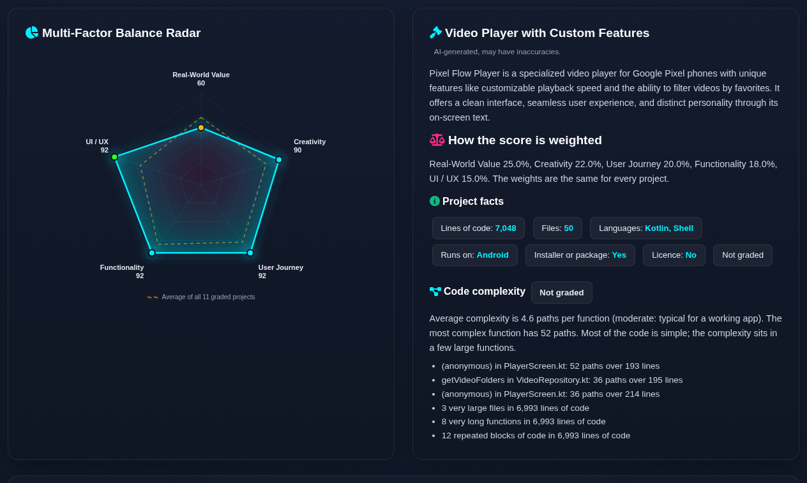
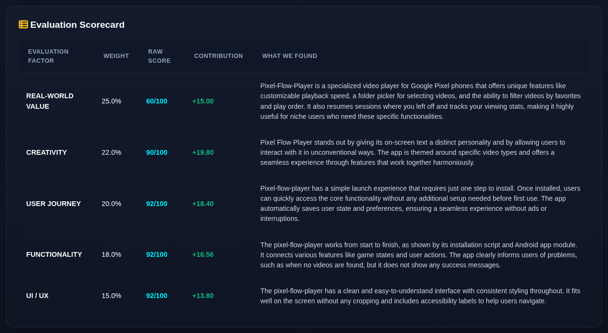
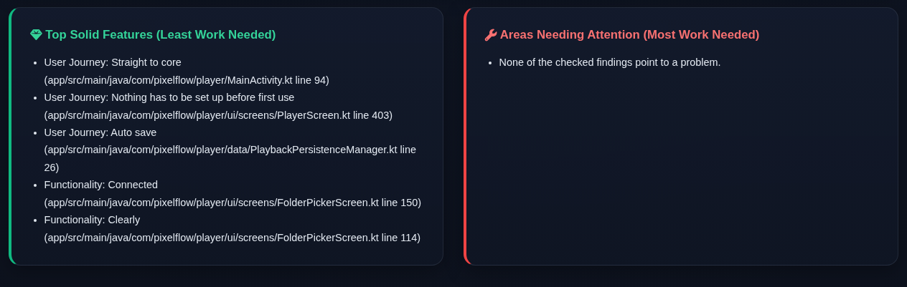
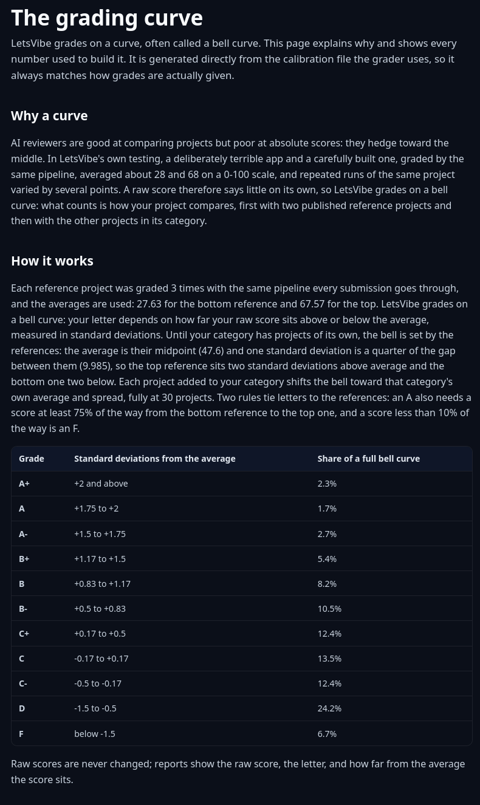
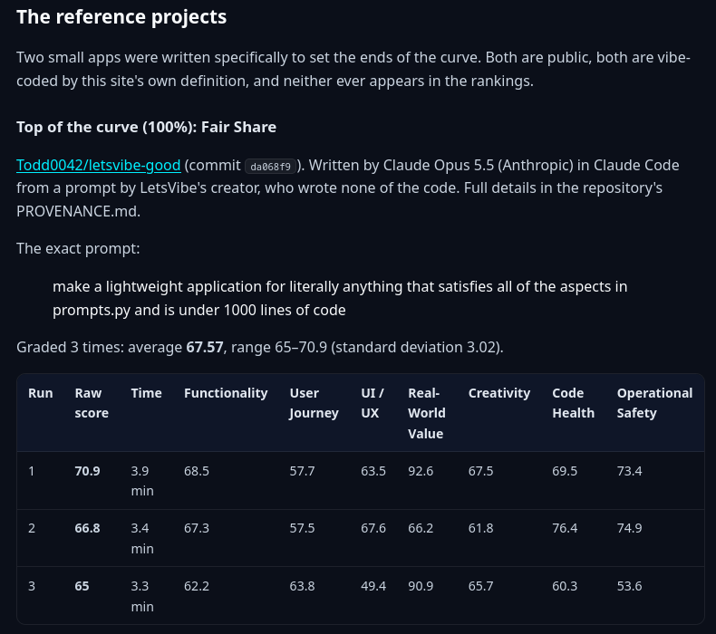
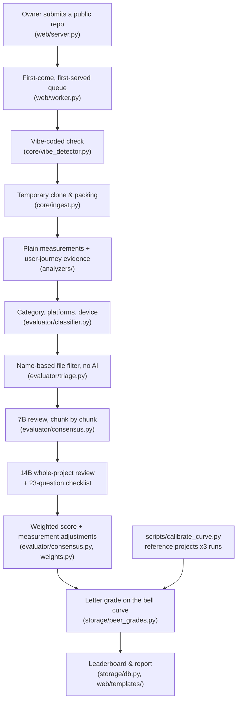
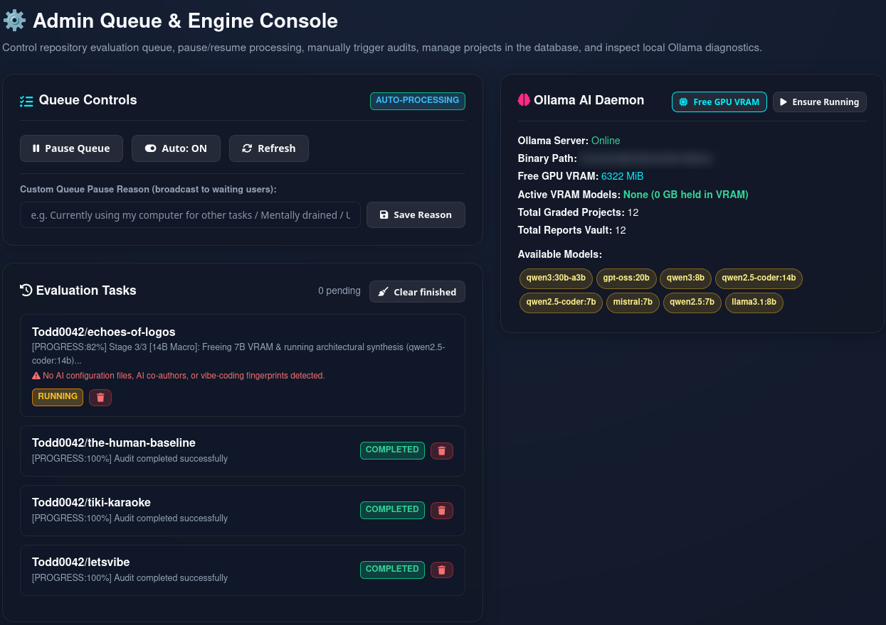

<p align="center">
  <a href="https://ko-fi.com/todd0042">
    
  </a>
</p>

---

# ✨ LetsVibe — The Leaderboard for Vibe-Coded Software

[](https://github.com/Todd0042/letsvibe/releases)
[](LICENSE)
[-blueviolet.svg)](https://letsvibe.todd0042.dev/changelog)
[]()
[-black.svg)](https://ollama.com)
[]()
[](https://ko-fi.com/todd0042)

> 🤖 *LetsVibe is itself vibe-coded: directed by [Todd0042](https://github.com/Todd0042), written by Antigravity (Gemini) and then Claude Code. [Who did what](#-3-how-letsvibe-itself-was-made).*

> **An independent, privacy-first leaderboard that grades vibe-coded software — programs written by AI from someone's prompts — against other vibe-coded software, never against professional developers. Every grade is produced by open AI models running on one local graphics card, anchored by plain code measurements, and placed on a fully published bell curve.**

🌐 **Live site:** [letsvibe.todd0042.dev](https://letsvibe.todd0042.dev)

<p align="center">
  
</p>

---

## 📖 Table of Contents

* **Part 1 — Overview**
  * [🎨 What Is LetsVibe?](#-what-is-letsvibe)
  * [🚀 How It Works in 3 Steps](#-how-it-works-in-3-steps)
  * [📸 Visual Tour](#-visual-tour)
  * [🧭 The 7 Factors](#-the-7-factors)
  * [🔔 Graded on a Published Bell Curve](#-graded-on-a-published-bell-curve)
  * [🔒 Privacy Promises](#-privacy-promises)
  * [🛠️ Run It Yourself](#️-run-it-yourself)
* **Part 2 — Technical Reference**
  * [1. Architecture & the Grading Pipeline ([evaluator/pipeline.py](letsvibe/evaluator/pipeline.py))](#1-architecture--the-grading-pipeline)
  * [2. Ingestion & the Name-Based File Filter ([core/ingest.py](letsvibe/core/ingest.py), [evaluator/triage.py](letsvibe/evaluator/triage.py))](#2-ingestion--the-name-based-file-filter)
  * [3. Plain Measurements & User-Journey Evidence ([analyzers/](letsvibe/analyzers/))](#3-plain-measurements--user-journey-evidence)
  * [4. Classification & Category Weights ([evaluator/classifier.py](letsvibe/evaluator/classifier.py), [evaluator/weights.py](letsvibe/evaluator/weights.py))](#4-classification--category-weights)
  * [5. Two-Model Review & the Evidence Checklist ([evaluator/consensus.py](letsvibe/evaluator/consensus.py))](#5-two-model-review--the-evidence-checklist)
  * [6. Scores, Letter Grades & the Bell Curve ([storage/peer_grades.py](letsvibe/storage/peer_grades.py))](#6-scores-letter-grades--the-bell-curve)
  * [7. The Website: Queue, Accounts, Privacy & Admin ([web/](letsvibe/web/), [storage/](letsvibe/storage/))](#7-the-website-queue-accounts-privacy--admin)
  * [8. CLI & Configuration](#8-cli--configuration)
  * [9. Repository Structure & Tests](#9-repository-structure--tests)
  * [10. Ethics, Privacy & Licensing](#10-ethics-privacy--licensing)

---

# Part 1 — Overview

## 🎨 What Is LetsVibe?

More and more software is **vibe-coded**: someone describes what they want, and an AI writes the program — often for a person who has never written code. That is a different thing from a professional developer using AI assistance at work, and it deserves a different yardstick.

**LetsVibe** grades vibe-coded projects as what they are:

1. **🏆 A public leaderboard** of graded GitHub projects, with a podium, filters by category and platform, factor-by-factor sorting and a Hall of Fame.
2. **📋 A detailed report for every project**: seven factor scores, what works, what needs attention, and separately, *what a professional team would do next* — useful, never insulting.
3. **🔍 A fully disclosed method**: how grading works, every rubric change, and every number behind the grading curve are published on the site.

---

## 🚀 How It Works in 3 Steps

1. **Sign in & submit**: Sign in with GitHub (public username, ID and avatar only — never your email) and submit a public repository **you own**. Nobody, including the site operator, can submit someone else's work.
2. **Local AI review**: A temporary copy of the project is measured with plain code analysis, then reviewed by two open AI models on LetsVibe's own graphics card — a 7B model reads the code chunk by chunk, a 14B model reviews the project as a whole and answers 23 concrete yes/no questions. The copy is deleted afterwards. Your code never goes to an AI company.
3. **Graded on a curve**: Your project gets a raw score and a letter grade from a published bell curve, plus its rank among similar projects. Delete it — or your whole account — yourself, at any time, from the live site and every backup.

---

## 📸 Visual Tour

### 🏆 The Leaderboard
A podium for the top three, then every graded project with its score, letter grade, rank in its category, platforms, a 7-factor balance strip and merit badges. Filter by grade, category and system, or sort by any single factor:

<p align="center">
  
</p>

### 📋 A Project Report
Every report shows the letter grade from the bell curve with the exact reason for it, the target device the project was judged for, and its merit badges:

<p align="center">
  
</p>

The radar is scaled to the project (0 at the centre, its best factor at the edge) with a dashed outline marking a typical vibe-coded project (62), next to the verdict, the reasoning behind the category's weights and the plain code measurements:

<p align="center">
  
</p>

| 🧮 7-Factor Scorecard | 🛠️ What Works, What Needs Work & Next Steps |
| :---: | :---: |
|  |  |
| *Weights, raw scores, contributions and the reviewers' observations* | *Strengths, gaps, and what a professional team would do next* |

---

## 🧭 The 7 Factors

What users experience carries most of the weight; engineering habits are reported as next steps.

| Factor | What it asks | Default weight |
| :--- | :--- | :---: |
| **Functionality** | Does it do what the README promises, with features wired together and bad input handled? | 20% |
| **User Journey** | From install and first-run setup, through finding your way (and how deep settings are buried), to finishing the main task and being told it worked. | 16% |
| **UI / UX** | Clarity, layout and feedback, judged for the target device (touch, keyboard, buttons, glanceable display, terminal). | 14% |
| **Real-World Value** | A genuine problem solved or real enjoyment for an identifiable audience. | 20% |
| **Creativity** | Custom mechanics, algorithms or inventive ideas beyond template code. | 11% |
| **Code Health** | Readable, organized code, not dominated by giant tangled functions. | 12% |
| **Operational Safety** | Doesn't hang, lose data or silently swallow errors; validates outside input. | 7% |

Weights adapt to the project's category within published ranges (a game weighs creativity more than a CLI tool does). **Size is never a quality signal**: story apps and content-heavy games are not marked down for their length.

---

## 🔔 Graded on a Published Bell Curve

AI reviewers are good at *comparing* projects but poor at absolute scores — they hedge toward the middle. In LetsVibe's own testing, a deliberately terrible app and a carefully built one averaged **27.6** and **67.6** on a 0–100 scale, never near either end. So letters come from a bell curve:

* **Before a category has projects of its own**, two public reference projects set the bell: [letsvibe-good](https://github.com/Todd0042/letsvibe-good) (written by AI to satisfy every factor) sits two standard deviations above average, and [letsvibe-bad](https://github.com/Todd0042/letsvibe-bad) (written by AI to ignore every factor) two below. Both were graded three times with the exact pipeline every submission goes through.
* **As a category grows**, its own average and spread take over, fully at 30 projects.
* **Two rails keep it honest**: an A also needs a score near the top reference, and a score about as weak as the bottom reference is an F, whatever the ranking.

The reference projects never appear in the rankings. Their exact prompts, the AI model that wrote them, every grading run and every number used are on the [Grading curve](https://letsvibe.todd0042.dev/grading-curve) page, generated directly from the calibration file the grader uses:

| 🔔 Why a Curve & How It Works | 📐 The Reference Projects & Every Run |
| :---: | :---: |
|  |  |
| *The method, the grade bands and each grade's share of a full bell* | *The exact prompt, the model that wrote it, and all three grading runs* |

---

## 🔒 Privacy Promises

* **🧾 Minimal data**: GitHub's `read:user` permission only — public username, numeric ID and avatar. No email address, ever. GitHub access tokens are used once and discarded.
* **🖥️ Local AI**: Models run on LetsVibe's own hardware via [Ollama](https://ollama.com). No AI provider receives code or data.
* **📵 No tracking**: No analytics, ads, trackers or third-party scripts. GitHub avatars are proxied so visitors' browsers never contact GitHub.
* **🗑️ Self-service deletion**: Export or delete one project, all projects or your whole account from **My Data**, instantly — removed from the live site and every backup at the same moment, with nobody notified.
* **🔞 Adults only**: Signing in creates an account, so the Terms of Use and Privacy Policy (18+, or the local age of majority if higher) are accepted first; the accepted version is stored with the account and deleted with it.

---

## 🛠️ Run It Yourself

### Requirements
* **Python 3.11+** and **git**
* **[Ollama](https://ollama.com)** with `qwen2.5-coder:7b` and `qwen2.5-coder:14b`
* A GPU with **8 GB of VRAM** or more (developed on an RTX 5060 Ti 8 GB; the 14B model runs partly on the CPU at that size)

### Grade a repository from the command line
```bash
git clone https://github.com/Todd0042/letsvibe.git
cd letsvibe
python -m venv .venv && .venv/bin/pip install -e .
ollama pull qwen2.5-coder:7b && ollama pull qwen2.5-coder:14b

# Grade a local folder or a GitHub URL (writes a terminal report; add --html / --markdown for files)
python letsvibe.py analyze https://github.com/owner/repo
```

### Run the website locally
```bash
cp .env.example .env        # then follow the instructions inside: admin ID, SESSION_SECRET, GitHub OAuth app
python letsvibe.py web      # http://127.0.0.1:8000 (leaderboard) and /admin (admin console)
```

---
---

# Part 2 — Technical Reference

> *The sections below describe LetsVibe `v1.0.0` (grading rubric `v7`) as implemented. Earlier rubric versions are listed on the site's [rubric changelog](https://letsvibe.todd0042.dev/changelog).*

---

## 1. Architecture & the Grading Pipeline

LetsVibe is a Python package ([letsvibe/](letsvibe/)) with a **FastAPI** web server, a single background **queue worker**, **SQLite** storage (WAL mode, `secure_delete`), and a framework-free HTML/JavaScript front end. One grading recipe ([evaluator/pipeline.py](letsvibe/evaluator/pipeline.py)) is shared by the website worker, the command line and the curve calibration script, so every grade on the site — the reference projects included — is produced the same way.



### GPU discipline ([evaluator/ollama.py](letsvibe/evaluator/ollama.py))
* **One grading at a time**: the worker processes the queue sequentially; the admin "Run next" button moves a task to the front instead of starting a second grading in parallel.
* **Fixed context window per model** (7B: 12,288 tokens; 14B: 6,144): changing `num_ctx` between calls forces Ollama to reload the model, so it never changes. Prompts that don't fit are trimmed from the end by LetsVibe itself, so the system prompt is never silently dropped.
* **Structured output**: every model call is constrained to a JSON schema; answers missing required scores are rejected and the evaluation fails closed rather than publishing a partial grade.

---

## 2. Ingestion & the Name-Based File Filter

* **Git-aware packing ([core/ingest.py](letsvibe/core/ingest.py))**: clones into a temporary folder (deleted afterwards), reads tracked files, skips bundled third-party libraries, binaries and lock files, and caps repositories at about 50 MB / 2,000 files.
* **Media by name only**: images, audio, video, fonts and 3D models are listed in the file tree by name so reviewers know they exist; their contents are never read.
* **Name-based file filter ([`select_for_review`](letsvibe/evaluator/triage.py))**: before any model sees the code, files are sorted by name and folder — no AI involved:
  * docs, licences, build/config files and tests are **not sent to the models** (they reach them as measurements, the README and the file tree);
  * story, dialogue, level and other content files are **sampled** (the largest few, first part only), so content-heavy projects are judged on what they contain, not their length;
  * everything else — program logic, screens, setup, input/output — is read in full.
* **Chunks of ~5,200 tokens**, each listing only its own files plus the project's top-level folders (instead of repeating the whole tree), which cut model reading by roughly a fifth.

---

## 3. Plain Measurements & User-Journey Evidence

Collected without AI in [`gather_metrics`](letsvibe/evaluator/pipeline.py):

| Measurement | Source | Used for |
| :--- | :--- | :--- |
| Cyclomatic complexity (average, max, worst functions) | [analyzers/complexity.py](letsvibe/analyzers/complexity.py) (Lizard) | Code-health adjustments |
| Possible hard-coded secrets (**type and count only**) | [analyzers/security.py](letsvibe/analyzers/security.py) | Safety adjustments; locations are never stored |
| Risky code patterns (`eval`, `exec`, `shell=True`, `dangerouslySetInnerHTML`), counted only in actual code, not comments or text | [analyzers/security.py](letsvibe/analyzers/security.py) | Smaller safety adjustment; locations are never stored |
| Tests, CI, packaging, licence, README | [analyzers/functionality.py](letsvibe/analyzers/functionality.py) | Evidence for reviewers and code-health credit |
| Platforms, hardware & device profile | [core/platforms.py](letsvibe/core/platforms.py) | Device-relative grading |
| User-journey evidence | [analyzers/journey_signals.py](letsvibe/analyzers/journey_signals.py) | Installers & launch scripts, README quick start, setup wizards (including in-page wizards), permission requests, screens/commands, settings depth, confirmations, error and empty states |

---

## 4. Classification & Category Weights

* **[evaluator/classifier.py](letsvibe/evaluator/classifier.py)** reads the README, file layout and build files to pick a general category (game, application, web app, tool, embedded, …) and target platforms.
* **[evaluator/weights.py](letsvibe/evaluator/weights.py)** holds a published weight-range row per category group; the model proposes weights and they are clamped into the row's ranges, so no category can quietly ignore a factor.

---

## 5. Two-Model Review & the Evidence Checklist

* **Pass 1 — 7B chunk review**: `qwen2.5-coder:7b` reviews every chunk, listing up to two strengths and two weaknesses per factor before scoring. For user journey, UI, operational safety and real-world value, a chunk only counts if it contains relevant code — except that **operational safety always counts** for code with network calls, subprocesses, threads, file I/O, endless loops or swallowed errors.
* **Pass 2 — 14B whole-project review**: `qwen2.5-coder:14b` reviews the project as a whole (README, full file tree, measurements, user-journey evidence, a code sample and the chunk findings) and writes the verdict, the peer summary and "what a pro team would do next".
* **Evidence checklist ([evaluator/checklist.py](letsvibe/evaluator/checklist.py))**: 23 yes/no questions (for example *"Can common settings be reached in one or two steps, rather than menus inside menus?"*), blended 50/50 with the model scores. Questions that measurements already answer, or that AI-written code nearly always passes, are not asked.
* **Shared reference class ([evaluator/prompts.py](letsvibe/evaluator/prompts.py))**: every prompt defines vibe-coded software, the score bands (62 = a typical working vibe-coded project) and the rule that size is never a quality signal.

---

## 6. Scores, Letter Grades & the Bell Curve

* **Score**: the factor scores are combined with the category's weights and adjusted by measurements ([evaluator/consensus.py](letsvibe/evaluator/consensus.py)): clean, low-complexity code earns code-health credit, widespread complexity costs it, and each possible secret costs operational safety (−6, up to −18) and each risky code pattern costs less (−3, up to −9).
* **Bell curve ([storage/peer_grades.py](letsvibe/storage/peer_grades.py))**: `z = (score − average) / standard deviation`. The reference projects set the starting bell (average = their midpoint, one standard deviation = a quarter of the gap); each category's own scores take over as it grows, fully at 30 projects.

| Grade | Standard deviations from the average | Share of a full bell |
| :---: | :--- | :---: |
| A+ / A / A- | +2.0 and above / +1.75 / +1.5 | ~6.7% |
| B+ / B / B- | +1.17 / +0.83 / +0.5 | ~24.2% |
| C+ / C / C- | +0.17 / −0.17 / −0.5 | ~38.3% |
| D | −1.5 to −0.5 | ~24.2% |
| F | below −1.5 | ~6.7% |

* **Calibration ([scripts/calibrate_curve.py](scripts/calibrate_curve.py))**: grades both reference projects several times through the shared pipeline and writes everything — every run, average, spread and the reference reports — to [letsvibe/data/curve_calibration.json](letsvibe/data/curve_calibration.json). The public Grading curve page is generated from that file, so the disclosure can't drift from what the grader uses. It is re-run whenever the models, rubric or pipeline change.

---

## 7. The Website: Queue, Accounts, Privacy & Admin

* **Accounts ([core/auth.py](letsvibe/core/auth.py), [core/legal.py](letsvibe/core/legal.py))**: GitHub OAuth (`read:user`), signed HttpOnly session cookies, and a signed anti-forgery state that also carries the accepted Terms version. Sessions only count while the account exists and has accepted the current Terms.
* **Ownership**: only a repository's owner can submit, re-grade, appeal or delete it — the admin included.
* **Queue ([web/worker.py](letsvibe/web/worker.py))**: first come, first served, shown in run order with each task's place in line.
* **Owner input & corrections ([storage/integrity.py](letsvibe/storage/integrity.py))**: when the review needs context about specific lines, the report is held privately until the owner explains them (deleted after 7 days without an answer). Owners can report factual errors in a review; each is checked against the code and corrected or reviewed by hand.
* **Privacy & deletion ([storage/backups.py](letsvibe/storage/backups.py), [web/privacy_jobs.py](letsvibe/web/privacy_jobs.py))**: weekly backups, only the two newest kept; every deletion is applied to the live database and every backup together, and a backup that cannot be cleaned is destroyed.
* **Admin console**: queue control, held reports, error reports, appeals, a developer tree with per-project deletion and a **"Delete all user data"** action for removal requests that arrive by email.

<p align="center">
  
</p>
* **Content pages ([web/templates/pages/](letsvibe/web/templates/pages/))**: How grading works, Grading curve, FAQ, rubric changelog, Privacy, Cookies, Terms, Remove my project, My Data and My Projects.

---

## 8. CLI & Configuration

### Command line ([letsvibe/cli.py](letsvibe/cli.py))
```bash
python letsvibe.py analyze <path-or-github-url> [OPTIONS]   # grade one repository
python letsvibe.py web [--host 127.0.0.1] [--port 8000]     # leaderboard + admin console
python letsvibe.py models                                   # list local Ollama models
```
| `analyze` option | Description |
| :--- | :--- |
| `--mode blend\|fast\|deep` | `blend` (7B + 14B, default), `fast` (7B only) or `deep` (14B only) |
| `--micro-model`, `--macro-model` | Override the Ollama models |
| `--context-tokens` | Chunk size (default 5,200, the same as the website) |
| `--html PATH`, `--markdown PATH`, `--json PATH` | Export the report |

### Environment variables ([.env.example](.env.example))
| Variable | Purpose |
| :--- | :--- |
| `SESSION_SECRET` | 32+ random characters used to sign sessions (without one, a random per-process secret is used and every restart signs everyone out) |
| `GITHUB_CLIENT_ID`, `GITHUB_CLIENT_SECRET`, `GITHUB_REDIRECT_URI` | Your GitHub OAuth app |
| `ADMIN_GITHUB_ID` (or `ADMIN_GITHUB_USER`) | The admin account, matched by numeric GitHub ID. There is no built-in admin: leave both empty and nobody is admin |
| `ADMIN_EMAIL` | Where appeal notifications go (optional; needs SMTP) |
| `SMTP_HOST`, `SMTP_PORT`, `SMTP_USER`, `SMTP_PASSWORD`, `SMTP_FROM` | Optional outgoing email for appeal notices |
| `MAX_REGISTERED_USERS` | Sign-up cap for non-admin accounts (default 5; `0` = private preview) |
| `SUBMISSIONS_PER_WINDOW`, `WINDOW_HOURS` | Fair-use limit per account (default 2 per 168 hours) |
| `LETSVIBE_DB_PATH` | Database location (default `data/letsvibe.db`) |
| `LETSVIBE_MAX_CTX`, `LETSVIBE_MAX_CTX_14B` | Context windows for the models (defaults 12,288 / 6,144) |
| `HOST`, `PORT` | Web server address |

---

## 9. Repository Structure & Tests

```
letsvibe/
├── letsvibe.py                  # Entry point (auto-uses .venv)
├── scripts/calibrate_curve.py   # Builds the grading curve from the reference projects
├── letsvibe/
│   ├── cli.py                   # analyze / web / models
│   ├── analyzers/               # Complexity, secrets (type only), tests & packaging, user-journey evidence
│   ├── core/                    # Ingestion, auth, terms, limits, platforms, vibe-coded check, data models
│   ├── evaluator/               # Shared pipeline, file filter, prompts, checklist, weights, consensus, Ollama client
│   ├── storage/                 # SQLite, bell curve, backups & deletion everywhere, held reports & corrections
│   ├── reporters/               # Terminal, Markdown and HTML reports
│   ├── data/curve_calibration.json  # Published curve calibration
│   └── web/                     # FastAPI server, queue worker, deletion jobs, image proxy, templates & static files
└── tests/                       # Unit, API and storage tests; tests/ui = browser tests (Playwright)
```

### Contributing & security
Bug reports and ideas are welcome as issues; code pull requests are not being accepted for now. See [CONTRIBUTING.md](CONTRIBUTING.md). Please report security problems privately as described in [SECURITY.md](SECURITY.md).

### Running the tests
```bash
.venv/bin/pip install -e .[dev]
.venv/bin/python -m pytest -q --ignore=tests/ui     # unit, API, storage and privacy tests
.venv/bin/python -m playwright install chromium
.venv/bin/python -m pytest -q tests/ui              # browser tests at phone, tablet and desktop sizes
```
Both suites run automatically on every push ([.github/workflows/tests.yml](.github/workflows/tests.yml)).
A permanent guard ([tests/test_no_secrets.py](tests/test_no_secrets.py)) fails the test run if any tracked file is a secret-type file or contains a secret-shaped value.

---

## 10. Ethics, Privacy & Licensing

LetsVibe is built around three commitments: **honest grading, user privacy, and full disclosure.**

### 🎯 1. Honest grading
* Vibe-coded software is compared with vibe-coded software only. Accuracy matters more than flattering scores; grades are automated opinions, not security audits or endorsements.
* Every rubric change is published, and the grading curve's reference projects, prompts and runs are public.

### 🔒 2. Privacy by design
* No email addresses, analytics, ads, trackers or third-party scripts; code is graded locally and the copy deleted; users delete their own data from the live site and every backup, with nobody notified.

### 🤖 3. How LetsVibe itself was made
LetsVibe is vibe-coded too: by this site's own definition, it is exactly the kind of project it grades. Its creator directed every decision and wrote none of the code.

| Contributor | Role |
| :--- | :--- |
| **[Todd0042](https://github.com/Todd0042)** | Creator: the idea, product direction, the privacy rules, the grading philosophy ("vibe-coded software graded as vibe-coded software", the bell curve), testing against real projects, and every review and decision |
| **Antigravity** (Google, Gemini models) | Wrote the original version, 2026-11-08 to 2026-11-11: the dual-model local analyzer and CLI, git-aware ingestion and chunking, archetype detection, the first web leaderboard with GitHub sign-in, quotas and 7-factor scoring, fail-closed scoring and the yes/no evidence checklist |
| **Claude Code** (Anthropic, Claude Opus 5.5) | Took over from 2026-11-11 to v1.0.0: the fix for silently truncated prompts, rubrics v6 and v7 (the vibe-coded reference class, user journey, the name-based file filter, the bell curve and its calibration), privacy and self-service deletion everywhere, terms acceptance, the admin tools, the model bake-off, the README, and the two reference projects ([letsvibe-good](https://github.com/Todd0042/letsvibe-good), [letsvibe-bad](https://github.com/Todd0042/letsvibe-bad)), as documented in their `PROVENANCE.md` files |

This public repository starts at v1.0.0 as a single commit. The earlier development history, including the trial and error behind rubrics v1 to v7, is summarized on the site's [rubric changelog](https://letsvibe.todd0042.dev/changelog).

### ⚖️ 4. License
* **[PolyForm Shield License 1.0.0](LICENSE)**: you may read, use, modify and share LetsVibe — for personal, educational, nonprofit or commercial purposes — as long as you don't use it to provide a product or service that competes with LetsVibe (for example, running a rival leaderboard for vibe-coded software). See the [LICENSE](LICENSE) for the exact terms.
* **The LetsVibe name and logo are not licensed.** The license covers the code only; please don't use the name or logo for your own projects or services.
* Questions: **[todd.0042.git@gmail.com](mailto:todd.0042.git@gmail.com)**.
* Third-party components (FastAPI, Uvicorn, Pydantic, Typer, Rich, Lizard, Jinja2, httpx, python-dotenv; Ollama and the Qwen2.5-Coder models at runtime) are used under their own licenses.

---

<p align="center">
  If LetsVibe has been useful or fun, consider supporting its development:<br/><br/>
  <a href="https://ko-fi.com/todd0042" target="_blank">
    
  </a>
</p>

---

<p align="center">
  <a href="https://ko-fi.com/todd0042">
    
  </a>
</p>
